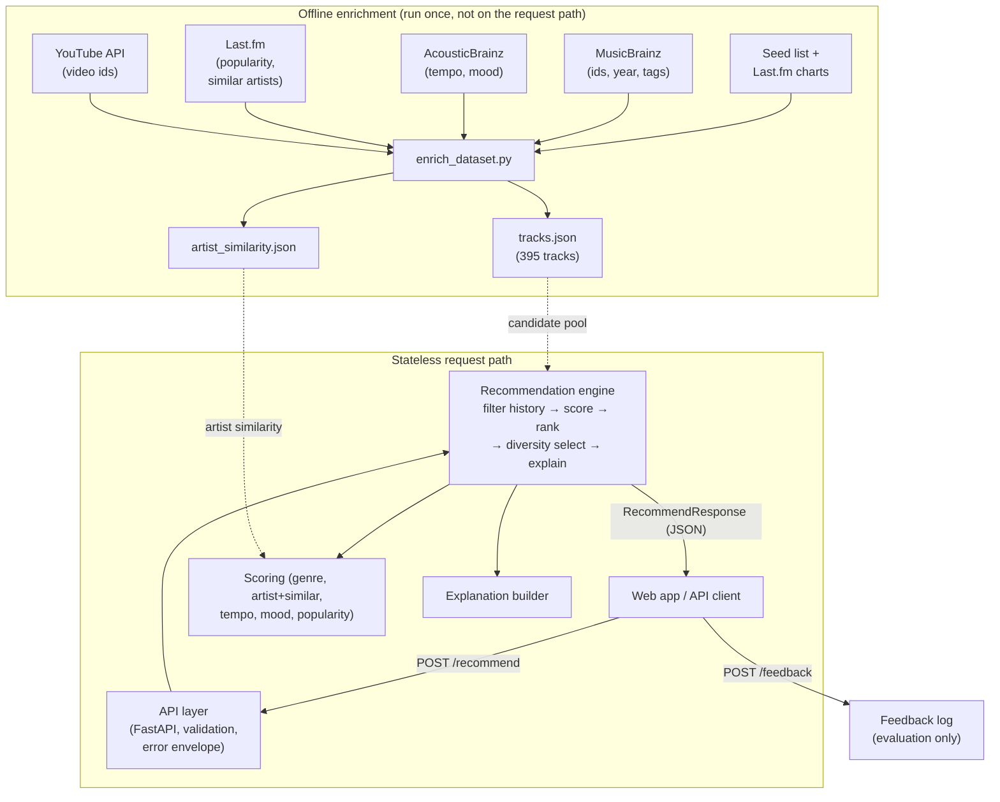
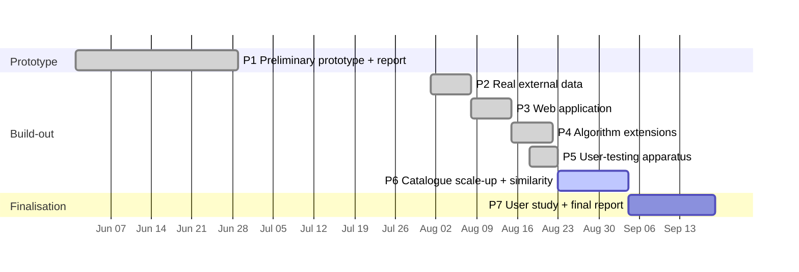

<!--
FINAL REPORT — NextTrack. Draft.
Structure: 6 chapters per the final-report requirements, with word limits:
  1 Introduction (1000) · 2 Literature Review (2500) · 3 Design (2000)
  4 Implementation (2000) · 5 Evaluation (2500) · 6 Conclusion (1000)
Front matter (title page, contents) and appendices are not counted.
Placeholders in << >> must be filled before submission.
Citation details: verify against HARVARD_REFERENCE_LIST.md.
-->

<div style="text-align:center; padding-top:120px;">

# NextTrack — A Stateless, Explainable Music Recommendation API

### Final Project Report

<br><br>

**<< University Name >>**

**<< Course / Module Code and Title >>**

<br>

**Student:** Sardar Muhammad Sachal &nbsp;·&nbsp; **Student ID:** << Student ID >>

**Supervisor:** << Supervisor Name >>

**Submission date:** 19 September 2026

</div>

<div style="page-break-after: always;"></div>

---

## Table of Contents

1. [Introduction](#chapter-1-introduction)
2. [Literature Review](#chapter-2-literature-review)
3. [Design](#chapter-3-design)
4. [Implementation](#chapter-4-implementation)
5. [Evaluation](#chapter-5-evaluation)
6. [Conclusion](#chapter-6-conclusion)
- [References](#references)
- [Appendices](#appendices)

<div style="page-break-after: always;"></div>

---

## Chapter 1: Introduction

### 1.1 Project concept and motivation

NextTrack is a music recommendation API: a web service that, given a listener's recent activity and stated preferences, returns a suitable next track to play. Recommender systems have become central to how users navigate large digital catalogues, helping people find relevant items when manual browsing is impractical (Adomavicius and Tuzhilin, 2005). Music is a particularly demanding domain, because tracks are short, are consumed in sequences rather than as one-off choices, and are strongly shaped by context and mood (Schedl et al., 2015). These characteristics turn the seemingly simple question — *what should play next?* — into a meaningful recommendation problem rather than a trivial lookup.

The motivation is to explore this problem with a deliberately lightweight and transparent design. The dominant commercial approach accumulates long-term data about each user and models their taste from it. This delivers strong personalisation but carries two well-known problems. First, it depends on **profiling and data retention**, with attendant privacy implications. Second, it is undermined by **shared accounts**: when several people (for example, a household with a child) use one account, their combined histories blur into a single, inaccurate profile — the familiar case where recommendations are polluted by nursery rhymes. These defects are inseparable from the assumption that one account corresponds to one stable set of preferences a system may record.

This motivates the question at the heart of the project: *can useful, explainable recommendations be produced from the information contained in a single request, without storing anything about the user between calls?* NextTrack investigates this by treating the user's recent history and explicit preferences as first-class inputs supplied at request time, and by justifying every suggestion with a plain-English explanation — reflecting the wider research interest in explainable recommendation, where systems explain their choices to support understanding and trust (Tintarev and Masthoff, 2007).

### 1.2 Project template

This project is undertaken using the supplied project template **Project Idea 2: NextTrack — A Music Recommendation API**, which specifies a request-driven recommendation service with *no user tracking*, that gives a "next track" based on an HTTP request providing listening history and preference parameters, and that draws on external data sources (such as MusicBrainz, Last.fm, and similar) to inform its choices.

### 1.3 Current challenges

The challenge is to define a recommendation strategy that is demonstrably better than random selection, is transparent enough to explain its choices, operates entirely within one stateless request, and draws its catalogue from real external data rather than behavioural logs. Beyond feasibility, the design must confront the recognised weaknesses of its chosen paradigm — notably content-based **over-specialisation** and **popularity bias** — and must ultimately be evaluated not only against its own objective but with real listeners.

### 1.4 Objectives and goals

The overall aim is to design, implement, and evaluate a stateless, explainable, content-based music recommendation API, demonstrated through a working, interactive prototype. The specific objectives are to:

1. Design a RESTful API that accepts a listening history, preference parameters, and available track data, and returns a recommended next track with an explanation.
2. Build a catalogue of real tracks from external metadata sources, offline, so that the request path remains stateless.
3. Implement an explainable content-based scoring method and extend it with session-aware taste inference, artist-similarity affinity, and a user-controllable diversity/discovery control.
4. Provide an interactive web application that plays recommended tracks and surfaces the explanation and score breakdown.
5. Validate the system with automated tests and evaluate it with an offline comparison against random selection, a weight-sensitivity analysis, an A/B comparison of the recommendation strategies, and apparatus for a user study.

The remainder of the report reviews the relevant literature (Chapter 2), presents the design (Chapter 3), describes the implementation and its algorithms (Chapter 4), reports the evaluation and a critical assessment (Chapter 5), and concludes (Chapter 6).

<div style="page-break-after: always;"></div>

---

## Chapter 2: Literature Review

### 2.1 Recommender systems: foundations and taxonomy

The foundational survey by Adomavicius and Tuzhilin (2005) established the now-standard taxonomy that organises recommendation approaches into three families: **content-based** methods, which recommend items similar to those a user has previously favoured; **collaborative filtering**, which exploits patterns across many users; and **hybrid** methods, which combine the two. This taxonomy remains the conceptual backbone of the field and is reflected in standard reference works such as the *Recommender Systems Handbook* (Ricci, Rokach and Shapira, 2011). Each family encodes a different assumption about *where recommendation knowledge resides* — in item attributes, in the community of users, or in a combination — and these assumptions carry practical consequences for data requirements, cold-start behaviour, privacy, and explainability that recur throughout this review.

### 2.2 Music recommendation

Although music recommendation inherits the general taxonomy, it differs from domains such as film or e-commerce in ways that materially affect design (Schedl et al., 2015). Music items are short and consumed in rapid succession, so the value of a track depends partly on what preceded it, making the *next-track* decision a meaningful sub-problem rather than an isolated ranking. Preference is also strongly shaped by context — activity, time, and especially mood — so the "right" recommendation can vary for the same user from moment to moment (Kaminskas and Ricci, 2012).

The knowledge a music recommender can draw on is itself varied: **editorial metadata** (genre, artist, year), **cultural data** (community tags and co-occurrence), and **audio content features** extracted from the signal. Purely audio-based content methods confront the well-known *semantic gap* between low-level acoustic descriptors and the high-level musical concepts listeners actually care about, which is one reason editorial and cultural signals remain valuable. NextTrack deliberately combines editorial metadata (genre, artist) with a small set of audio-derived features (tempo and mood, obtained from AcousticBrainz) and cultural popularity and artist-similarity data (from Last.fm), rather than attempting signal-level modelling. Celma (2010) further highlights the long-tail structure of music catalogues and the resulting **popularity bias**, whereby a few well-known tracks dominate recommendations at the expense of discovery, while later surveys catalogue the field's open challenges including cold start, context-awareness, and the difficulty of meaningful evaluation (Schedl et al., 2018). For NextTrack, the key implication is that short, sequential, context-sensitive listening lends itself to a request-driven model in which recent history and explicit preferences are supplied at the moment of the request, and that popularity should be used only sparingly to avoid amplifying the long-tail bias Celma identifies.

### 2.3 Content-based recommendation

Content-based recommendation derives suggestions from item attributes, recommending items similar to those a user has shown interest in (Pazzani and Billsus, 2007). Its strengths are well documented (Lops, de Gemmis and Semeraro, 2011): because it depends only on item features and a statement of preference, it handles new items gracefully and needs no data about other users, and it is comparatively **transparent**, since a recommendation can be explained by the specific attributes that matched. Its recognised weakness is **over-specialisation** — recommendations that remain narrowly similar to past preferences and offer limited novelty — and a dependence on the richness and accuracy of the available metadata; content-driven approaches increasingly draw on richer audio and metadata features to mitigate this (Deldjoo, Schedl and Knees, 2021). This paradigm aligns closely with NextTrack's goals: its independence from user-interaction data supports a stateless, privacy-conscious design, and its transparency supports the explanation feature. The over-specialisation weakness is directly relevant and is addressed by a diversity control (Chapter 4).

### 2.4 Collaborative filtering

Collaborative filtering (CF) recommends items by learning from the behaviour of many users. It divides broadly into **memory-based** neighbourhood methods — which come in *user-based* form (recommend what similar users liked) and *item-based* form (recommend items similar to those a user engaged with, where similarity is computed from co-engagement) — and **model-based** methods, most influentially latent-factor models such as matrix factorisation, which embed users and items in a shared low-dimensional space (Koren, Bell and Volinsky, 2009). A second axis is the *type of feedback* exploited: **explicit** feedback (ratings) versus **implicit** feedback (plays, skips, dwell time). Music systems rely overwhelmingly on implicit feedback, because explicit ratings are scarce and interaction is continuous — which ties music CF even more tightly to behavioural logging than in domains where users rate items directly.

CF requires no item metadata and can surface non-obvious associations that content features miss, which is why it underpins many large commercial systems. However, its strengths are inseparable from its reliance on accumulated personal data. The most prominent difficulty is the **cold-start problem**, which itself has distinct forms — new *users*, new *items*, and new *systems* all lack the interaction data CF depends on (Schein et al., 2002). By construction, CF also requires the system to *collect and retain* user histories, raising the privacy and shared-account concerns discussed in Chapter 1: the item-based and latent-factor machinery that makes "listeners who liked this also liked…" possible is exactly the machinery that builds a persistent behavioural profile. NextTrack therefore does not implement CF, while recognising it as a candidate for future hybridisation; notably, its own "artists you've been playing / similar artists" signal (Chapter 4) captures a *lightweight, stateless* echo of the item-based collaborative idea, using pre-computed artist-similarity data (a static, non-personal artifact) rather than a stored user profile.

### 2.5 Hybrid recommendation

Hybrid systems combine paradigms to offset the weaknesses of any single approach; Burke (2002) provides an influential survey of hybridisation strategies including weighted, switching, and feature-combination designs. In music, hybrids are frequently advocated to balance accuracy with discovery and to incorporate contextual signals (Schedl et al., 2018). They are not a universal remedy — they increase complexity, can be harder to explain, and often reintroduce CF's data requirements. For a system prioritising statelessness, transparency, and simplicity, a full hybrid would be premature, so NextTrack is scoped as content-based with hybridisation identified as future work.

### 2.6 Explainable recommendation

Explainability has become a significant research theme, motivated by the observation that users benefit not only from accurate recommendations but from understanding *why* an item was suggested. Tintarev and Masthoff (2007) articulate distinct aims an explanation may serve — including transparency, trust, effectiveness (helping users make good decisions), and satisfaction — and stress that these can require *different* explanation designs, so an explanation optimised for trust is not necessarily one optimised for helping a user decide. A useful distinction in the later literature is between **model-intrinsic** explanations, which arise naturally from an inherently interpretable model, and **post-hoc** explanations, which are generated separately to justify the output of an opaque model; and between explanation *styles*, such as feature-based, item-based ("because you liked X"), and user-based justifications (Zhang and Chen, 2020). A key insight for this project is that the explanation style should suit the underlying method: content-based systems are naturally suited to **model-intrinsic, feature-based explanations**, because the very attributes that drive a recommendation can be surfaced directly as its justification, with no separate and potentially unfaithful post-hoc step. NextTrack exploits this alignment directly, accompanying every recommendation with a natural-language explanation composed only from the features and session signals that actually contributed to the score — and, importantly, one that distinguishes an explicit preference match from a session-inferred one and an exact artist from a similar one, so the explanation is a faithful reflection of the computation rather than a plausible-sounding rationalisation.

### 2.7 Stateless, session-based, and privacy-conscious recommendation

A growing body of work studies recommendation that relies on *recent interactions* rather than long-term profiles. Sequence-aware and session-based recommender systems generate suggestions from the current sequence of actions and can operate without persistent user models (Quadrana, Cremonesi and Jannach, 2018); context-aware recommendation similarly argues that contextual parameters should be treated as first-class inputs to the recommendation function (Adomavicius and Tuzhilin, 2011). This is conceptually close to NextTrack, which treats each request as a self-contained session. Statelessness is additionally a defining constraint of the REST architectural style (Fielding, 2000), which NextTrack adopts through its FastAPI implementation. The convergence is notable: an architectural principle (REST statelessness), a recommendation strategy (session-based, content-driven), and a privacy posture all point toward the same request-driven design.

### 2.8 Evaluation of recommender systems

Evaluation methodologies fall into three broad families: **offline** experiments on historical data or a defined objective; **online** experiments (such as A/B tests) on live user traffic; and **user studies** with recruited participants. Offline evaluation is the most widely used because it is reproducible and inexpensive (Herlocker et al., 2004), and comparison against a **random-selection baseline** is a common, defensible way to establish that a method beats chance; the choice of baseline matters, however, since a baseline drawn from already-relevant items is far more demanding than one drawn from the whole catalogue — a point that becomes concrete in NextTrack's own evaluation (Section 5.2).

Crucially, the literature is emphatic that accuracy-style metrics alone are insufficient. Beyond accuracy, recognised quality dimensions include **coverage** (how much of the catalogue is ever recommended), **novelty**, **diversity**, and **serendipity**. McNee, Riedl and Konstan (2006) argue that an exclusive focus on accuracy has at times *harmed* recommender systems by neglecting exactly these qualities and genuine user satisfaction, and Celma (2010) warns that high offline accuracy may mask popularity bias and poor discovery. These cautions directly shaped this project: they motivated both the diversity control (a novelty mechanism) and an evaluation that deliberately spans several complementary offline measures — an accuracy-style random comparison, a robustness analysis, and a coherence-based A/B — plus a user study, rather than resting on a single accuracy number. The offline results establish feasibility and internal validity, while the user-centred study is required to assess perceived quality (Chapters 3 and 5).

### 2.9 Comparison of techniques and relevance to NextTrack

The literature reveals a consistent set of trade-offs, summarised in Table 2.1. Collaborative filtering offers powerful cross-user discovery but depends on accumulating personal data, with attendant cold-start, shared-account, and privacy difficulties; content-based methods sacrifice some discovery but are transparent, resilient to item cold-start, and independent of user data; hybrids combine strengths at the cost of complexity; and across all paradigms, explanation and rigorous, user-aware evaluation are recognised as important but frequently underdeveloped. NextTrack occupies a coherent point in this landscape: it is **content-based** (for transparency and cold-start resilience), **stateless and session-driven** (aligning with REST principles and reducing reliance on stored profiles), **explainable**, and **API-focused**, and it deliberately targets the over-specialisation and popularity-bias weaknesses the literature identifies through its diversity control and low popularity weighting.

**Table 2.1 — Comparison of recommendation approaches and their relevance to NextTrack**

| Approach | Knowledge source | Data required | Key strengths | Key weaknesses | Used in NextTrack? |
|---|---|---|---|---|---|
| **Content-based** (Pazzani & Billsus, 2007; Lops et al., 2011) | Item attributes + stated preference | Item metadata only | Transparent; no item cold-start; no stored profile | Over-specialisation; bounded by metadata quality | **Yes — core method** |
| **Collaborative filtering** (Koren et al., 2009; Schein et al., 2002) | Behaviour of many users | Large accumulated interaction logs | Strong accuracy; surfaces non-obvious links | Cold-start; profiling/retention; shared-account failure | No (privacy); echoed via similar-artist data |
| **Hybrid** (Burke, 2002) | Combination of the above | Metadata *and* interaction data | Offsets single-method weaknesses | Complexity; harder to explain; inherits CF data needs | No — future work |
| **Session-/sequence-based** (Quadrana et al., 2018) | Current interaction sequence | Recent actions only | Works without persistent profile; privacy-friendly | Limited long-term personalisation | **Yes — session-aware inference** |
| **Explainable methods** (Tintarev & Masthoff, 2007; Zhang & Chen, 2020) | Justification layer over any method | Depends on base method | Improves transparency, trust, satisfaction | Explanation must fit base method | **Yes — feature-based explanations** |

The claim of this project is intentionally modest: NextTrack does not solve the open problems of music recommendation, nor does it match the personalisation of data-intensive systems. It demonstrates that a privacy-conscious, explainable, content-based next-track API is feasible and useful, providing a foundation that richer features, deeper hybridisation, and larger-scale user evaluation can extend.

<div style="page-break-after: always;"></div>

---

## Chapter 3: Design

### 3.1 Overview, domain, and users

NextTrack operates in the domain of music recommendation, focusing on the *next-track selection* task: choosing a single track to continue an active listening session. The full intended system is a stateless, request-driven RESTful service that recommends the next track from a listener's recent history, preference parameters, and available track metadata, returning the chosen track with a transparent explanation. It serves two groups: **direct users** — developers and client applications that send structured JSON requests and need predictable, well-documented, stateless behaviour; and **indirect users** — listeners, who experience the recommendations, explanations, and playback through a client application (here, the bundled web app). Both are served by computing every recommendation purely from the current request and by making its reasoning inspectable.

### 3.2 Design choices and the recommendation method

**Stateless, request-driven design.** The defining choice is that all recommendation context — history, preferences, and (optionally) the candidate pool — is supplied *in the request*, and nothing about the user is stored between calls. This aligns with the REST statelessness constraint (Fielding, 2000) and with session-based recommendation (Quadrana et al., 2018), and it is what gives the system its privacy properties.

**Weighted content-based scoring.** The core method scores each candidate as a weighted sum of five per-feature sub-scores, each in [0, 1] (the formulas are given in Chapter 4). The design decision recorded here — which the preliminary feedback asked to be justified rather than merely stated — is the choice of default weights (Table 3.1). Each weight is set by considering three things together: the feature's **role** in how listening sessions work; its **reliability** as a signal in the available metadata; and the **project's goals** (transparency, session continuation, and discovery rather than popularity bias). A feature strong on role but weak on reliability is deliberately weighted *down* — the asymmetry that turns the numbers into an argument.

**Table 3.1 — Default scoring weights and their justification**

| Feature | Weight | Justification |
|---|---|---|
| **Genre** | 0.40 | The most robust, low-noise axis of similarity and the primary way listeners organise sessions; almost always present in metadata. High role *and* reliability, so it earns the plurality — but below 0.5, so it never single-handedly decides. |
| **Artist** | 0.20 | A strong affinity signal, but below genre because over-weighting exact-artist match causes over-specialisation and repetition (Lops et al., 2011). Extended to *similar* artists (Chapter 4). |
| **Tempo** | 0.20 | The axis of energy/flow continuity curators sequence on; a *continuous* signal capturing nuance the binary matches cannot. Equal to artist, but no higher as it needs reliable tempo data and a target. |
| **Mood** | 0.10 | Contextually important (Kaminskas and Ricci, 2012) but weighted *down* on reliability: mood metadata is subjective, sparse, and low-cardinality, making an exact match noisy — the role-vs-reliability trade-off. |
| **Popularity** | 0.10 | A weak quality prior and tie-breaker, kept deliberately low to resist **popularity bias** (Celma, 2010). |

The set encodes a hierarchy — robust categorical similarity (genre) > specific affinity and flow (artist, tempo) > important-but-noisy signals (mood, popularity) — with no feature reaching 0.5 and weights summing to 1.0, so the total is interpretable as a fraction. Critically, these defaults are a *sensible prior, not a claim of optimality*: they are overridable per request (giving the user real control), and their robustness is demonstrated empirically by the sensitivity analysis in Chapter 5. Two honest caveats: a *zero* popularity weight is defensible for a pure-discovery tool, and exact-mood matching is coarse; both are revisited as future work.

**Explicit preferences as hard filters.** A refinement that emerged from testing (Chapter 5) is that an *explicitly chosen* genre or mood is treated as a hard filter, not merely up-weighted — because mood's low weight otherwise lets an explicit choice be swamped. *Inferred* preferences stay soft, so the session still flows while the user's explicit selection always wins.

### 3.3 System architecture

The system is a **layered pipeline** plus an **offline enrichment stage** (Figure 3.1), so each concern can be developed, tested, and replaced independently. The request path is fully stateless and calls no external service; all external data is fetched *once*, offline, and baked into a static catalogue.

**Figure 3.1 — NextTrack system architecture** *(rendered from the Mermaid source; export at mermaid.live for a high-resolution image to embed)*



A request flows as follows: the client posts to `/recommend`; the **API layer** validates it with Pydantic (rejecting malformed input with HTTP 422) and selects the candidate pool (the request's own candidates, or the bundled catalogue from the data layer); the **recommendation engine** excludes history tracks, applies explicit genre/mood filters, scores the remainder, ranks deterministically, applies the diversity control, and generates an explanation; the result is serialised as JSON. Because no per-user state is retained, the architecture satisfies REST statelessness (Fielding, 2000). The **feedback endpoint** and **enrichment stage** are deliberately outside the request path — the former is the single place any data is written (anonymous evaluation ratings), and the latter performs all external calls in advance so the live service is fast, predictable, and independent of third-party availability or rate limits.

### 3.4 Technologies

The system is implemented in **Python** with **FastAPI** (automatic validation and interactive OpenAPI docs) and **Pydantic** (typed request/response models), served by **Uvicorn**, and tested with **Pytest**; the offline enrichment uses **httpx**. The web application is a dependency-free HTML/CSS/JavaScript page using the **YouTube IFrame API** for login-free, full-length playback. External data comes from **MusicBrainz** (canonical metadata), **AcousticBrainz** (tempo, mood), **Last.fm** (popularity, artist similarity), the **YouTube Data API** (playback ids), and the **Cover Art Archive** (art); the first two and Cover Art Archive are key-free, while Last.fm and YouTube use free API keys. These lightweight, well-documented technologies suit a stateless API that prioritises clarity, and the JSON-first design means no database is needed at this scale, while the layered structure would allow one to be added behind the data layer without touching the recommendation logic.

### 3.5 Workplan and evaluation strategy

The project ran in phases from the preliminary submission to the final report (Table 3.2, Figure 3.2). The evaluation strategy, detailed in Chapter 5, verifies **correctness** with automated tests and assesses **recommendation quality** in three offline ways (comparison against random, a weight-sensitivity analysis, and a session-aware-versus-baseline A/B on session coherence) plus a **user-centred study**, since the literature warns that accuracy alone is insufficient (McNee et al., 2006).

**Table 3.2 — Development milestones**

| Phase | Tasks | Target |
|---|---|---|
| P1 — Preliminary prototype | Stateless API, content-based scoring, history exclusion, explanation, tests, random-baseline evaluation, preliminary report | Late June 2026 |
| P2 — Real external data | Offline enrichment (MusicBrainz + AcousticBrainz + Last.fm + YouTube); reproducible catalogue | Aug wk 1 |
| P3 — Web application | Single-page front end, YouTube player, explanation/breakdown visualisation | Aug wk 2 |
| P4 — Algorithm extensions | Session-aware inference, artist affinity, diversity control; sensitivity analysis | Aug wk 3 |
| P5 — User-testing apparatus | Blind A/B study mode, feedback endpoint, analysis script, protocol | Aug wk 4 |
| P6 — Catalogue scale-up & similarity | Last.fm chart seeding to 395 tracks; artist-similarity map + graded affinity; explicit-preference filtering | Sep wks 1–2 |
| P7 — Final report & study | Run the user study; write and revise the report addressing feedback | By 19 Sep 2026 |

**Figure 3.2 — Project schedule (Gantt)**



The principal feasibility risks — dataset breadth/quality, the effort of integrating several external sources, and time for user evaluation — were mitigated by the layered architecture (enrichment and evaluation added without changing the engine), an on-disk cache making enrichment re-runs cheap and resumable, and building the study apparatus early.

<div style="page-break-after: always;"></div>

---

## Chapter 4: Implementation

This chapter describes the implementation to date: the major algorithms, the most important parts of the code, the data pipeline, the web application, and a visual representation of the results.

### 4.1 API behaviour

The central endpoint, `POST /recommend`, accepts a JSON body with a `history` list of track ids, a `preferences` object (`genre`, `mood`, `target_tempo`, `preferred_artist`, `weights`, `session_aware`, `diversity`), and an optional `candidates` list; when candidates are omitted, the bundled catalogue is used. Validation is declarative: the request is a Pydantic model, and constraints such as `0 ≤ diversity ≤ 1`, `rating ∈ [1,5]` (for feedback), and non-empty text fields are enforced by the schema, so malformed requests are rejected with HTTP 422 *before any recommendation logic runs*. A successful response returns the recommended track, its total score, a per-feature score breakdown, a natural-language explanation, and ranked alternatives; error paths return a consistent envelope (404 when nothing remains to recommend, 400 for invalid weights). Supporting endpoints are `GET /catalogue` (with a `playable_only` filter the web app uses so it never surfaces an unplayable track), `GET /health`, and `POST /feedback`.

The API layer itself is deliberately thin: it validates, selects the candidate pool, delegates to the recommender, and translates the recommender's exceptions into HTTP responses. All recommendation logic lives in a separate, framework-independent core (`app/core`), which keeps the engine unit-testable without a web server and would allow the web layer to be replaced without touching the algorithm.

### 4.2 The recommendation pipeline

The core `recommend()` function is a single, stateless pipeline. Its stages, in order, are: (1) reject the request if no candidates exist; (2) normalise candidates to dictionaries and drop duplicate ids; (3) resolve the history ids to full track records *from the pre-exclusion pool* and build the session context (so the history's own genres, moods, tempos, and artists can be read before those tracks are removed); (4) exclude any track already in the history, and (4b) apply explicit genre/mood hard filters; (5) resolve and normalise the weights; (6) score every remaining candidate; (7) sort by the deterministic key; (8) select the recommendation via the diversity control; and (9) build the explanation and the ranked alternatives. Ordering step 3 *before* step 4 is a deliberate design point — it is what lets the session signals survive history exclusion. Because the function takes only its arguments and returns only a result object, with no I/O or persistence, it is trivially reproducible and directly testable, and it is the sense in which the whole service is "stateless".

### 4.2 The scoring model

Each candidate *c* receives a total score that is a weighted sum of five sub-scores, each in [0, 1]:

```
score(c) = w_genre·s_genre + w_artist·s_artist + w_tempo·s_tempo
         + w_mood·s_mood + w_popularity·s_popularity,   with Σ w_f = 1
```

The sub-scores are: `s_genre`/`s_mood` = 1 on an exact match else 0; `s_tempo = max(0, 1 − |tempo − τ*| / 60)`; `s_popularity = popularity / 100`; and the artist score is described in 4.4. Weights are normalised (`w_f = W_f / ΣW`) with negative or all-zero weights rejected. The core of the engine builds this breakdown and total for every candidate:

```python
raw = {
    "genre": score_genre(track["genre"], context.genre),
    "artist": score_artist_affinity(track["artist"], context.preferred_artist,
                                     context.history_artists, similar_artists),
    "tempo": score_tempo(track["tempo"], context.target_tempo),
    "mood": score_mood(track["mood"], context.mood),
    "popularity": score_popularity(track["popularity"]),
}
breakdown = {f: round(raw[f] * weights[f], 4) for f in SCORING_FEATURES}
total = round(sum(breakdown.values()), 4)
```

The per-feature `breakdown` is returned to the client and drives both the explanation and the score-breakdown visualisation, making the model's reasoning fully transparent.

### 4.3 Session-aware taste inference

When `session_aware` is enabled (the default) and a preference is not explicitly supplied, it is inferred from the five most recent history tracks, so recommendations follow the flow of the session: `g*` = the most common recent genre, `m*` = the most common recent mood, `τ*` = the mean recent tempo. Explicit preferences always take priority, and an explicit genre or mood additionally acts as a hard filter on the pool (4.6), so a low-weight but explicit choice such as mood is always honoured. The engine resolves the history ids to full tracks (from the pre-exclusion pool) precisely so these session signals can be read.

### 4.4 Similar-artist affinity

The artist sub-score captures explicit, session, and *similar-artist* affinity. With a seed set *S* of the preferred artist plus the recent history artists, and a pre-computed Last.fm similarity map `similar(a)`:

```python
def score_artist_affinity(candidate_artist, preferred_artist, history_artists, similar_map):
    ca = candidate_artist.lower()
    seeds = {a.lower() for a in ({preferred_artist} | (history_artists or set())) if a}
    if ca in seeds:
        return 1.0                                   # exact affinity
    if similar_map and any(ca in similar_map.get(s, ()) for s in seeds):
        return 0.6                                   # similar-artist affinity
    return 0.0
```

This implements a stateless "more from artists you've been playing, and from related artists" signal — a lightweight echo of the collaborative idea — using only the request's history and static reference data (the map is built offline from Last.fm's `artist.getSimilar`). The value 0.6 sits below the exact-match score so an exact artist still wins, but well above 0 so related artists are meaningfully preferred. In practice, playing a Radiohead track leads the engine to recommend Nirvana, explained as *"by Nirvana, an artist similar to your session."*

### 4.5 Deterministic ranking and the diversity control

Candidates are ranked by a deterministic key — total score, then popularity, then newer year, then smaller id — guaranteeing reproducible output. The recommendation is then selected by the diversity control *d* ∈ [0, 1]. At *d* = 0 the top-ranked track is returned. For *d* > 0 a **score-aware window** of candidates within *d* of the best score is formed and the pick is drawn with probability proportional to score:

```python
threshold = best_total * (1.0 - diversity)
window = [s for s in scored if s["total"] >= threshold][:12]
# then weighted-random choice over window, seeded from the request
```

The window is score-aware rather than a fixed size, which is the key design point: when many candidates tie (a broad genre request) the window is wide and results vary, but when one candidate is clearly better (the only track by a requested artist) the window collapses to it and it is *not* diluted. This directly counters content-based over-specialisation while preserving strong, specific matches, and sampling is seeded from the request so behaviour is reproducible yet explores across a session. The winning track's **explanation** is then assembled only from the reasons that actually contributed, distinguishing explicit matches from session-inferred ones and exact artists from similar ones, and never claiming a match that did not occur.

### 4.6 The offline enrichment pipeline

The 395-track catalogue is built by `enrich_dataset.py` from a reproducible seed — a fixed hand-curated list augmented by Last.fm chart tracks per genre (`tag.getTopTracks`) — with each seed then enriched from several sources. The key technical detail is a **two-database dependency for audio features**: AcousticBrainz is keyed by MusicBrainz recording id, so the pipeline first resolves a track to one or more candidate ids via a MusicBrainz search, then queries AcousticBrainz for tempo (from the `rhythm.bpm` field of the low-level endpoint) and mood (from the high-level mood classifiers — `mood_happy`, `mood_relaxed`, `mood_aggressive`, and so on — collapsed onto the project's calm/energetic/happy vocabulary). Because not every recording has been analysed in AcousticBrainz, the pipeline *probes several candidate ids per track and keeps the first that returns a real BPM*, which materially raises the proportion of tracks with genuine audio features rather than fall-backs. Popularity is derived from Last.fm listener counts on a logarithmic scale, and the artist-similarity map is built from Last.fm's `artist.getSimilar`; of the 199 artists in the catalogue, **179 have at least one similar artist that is also present in the catalogue**, which is what makes the similar-artist signal effective in practice rather than merely in principle.

Robustness and reproducibility were explicit design goals of the pipeline. Every external call is **rate-limited** (respecting MusicBrainz's one-request-per-second guideline) and **cached to disk**, so re-runs are fast and resumable and a single failed lookup never aborts a build; where external data is missing, per-genre defaults fill tempo and mood so every seed still yields a schema-valid record. Because the seed is fixed, the catalogue is fully **reproducible** — unlike live charts, which change daily and would make evaluation non-repeatable. One practical constraint shapes what is *playable*: the YouTube Data API's free daily quota (~100 lookups) limits how many playback ids can be resolved at once, so at present **102 of the 395 tracks are playable**, with the remainder carrying full metadata and similarity data that still improve the recommender's scoring; playback ids backfill over successive days as the quota resets and are cached permanently. The pipeline's outputs are a static `tracks.json` and an `artist_similarity.json` map, both read by the live API, which itself calls no external service.

### 4.7 The web application and visual results

A single self-contained page (no build step or external front-end dependencies), served by the same backend, provides the interactive experience: preference controls (including the variety slider and the session-adaptation toggle), a *Recommend next* action, an embedded YouTube player, the explanation and score-breakdown bars, and a session-history list. A deliberate design decision keeps the whole application consistent with the project's premise: the **session history lives entirely in the browser** and is sent with each request, so the client is fully interactive while the server stores nothing between calls. The page requests only playable tracks (`playable_only`) so it never offers a track it cannot play.

The application also embeds the **user-study apparatus** (evaluated in Chapter 5). A blind *study mode* randomly assigns the session-aware or baseline method to each recommendation and hides the method — and the explanation and breakdown, which would otherwise reveal it — then collects a 1–5 relevance rating. Ratings are sent to a separate `POST /feedback` endpoint and appended, anonymously, to a log file; this is the *only* place the system writes data, and it is kept deliberately outside the recommender so that recommendation itself remains stateless and no rating is ever fed back into a user profile.

Each track is described by a small, validated data model — `id`, `title`, `artist`, `genre`, `tempo`, `mood`, `year`, and `popularity`, plus presentation fields (`youtube_id`, `cover_url`, `mbid`) that play no part in scoring — and the same Pydantic `Track` model validates both the bundled catalogue and any candidates supplied inline in a request. Figure 4.1 shows a recommendation playing with its explanation and score breakdown; Figure 4.2 shows a session building a coherent set across successive recommendations; Figure 4.3 shows the blind study-mode rating widget. *(Insert screenshots — Appendix B.)*

<div style="page-break-after: always;"></div>

---

## Chapter 5: Evaluation

This chapter reports the evaluation carried out to date and gives a critical assessment of the whole project — not only the feature prototype — making clear what has been achieved and what can be improved. All quantitative results are reproducible via the repository's scripts with a fixed random seed.

### 5.1 Correctness: automated testing

Testing follows the layered architecture, so each layer is verified in isolation and then end-to-end. Because the scoring and recommendation logic are written as **pure functions** with no I/O or global state, they can be tested directly with concrete inputs, and the API is tested through FastAPI's in-process test client without a running server. The suite currently comprises **55 tests** (Table 5.1), run with `pytest`.

**Table 5.1 — Automated test suite**

| Test module | Tests | Coverage |
|---|---|---|
| `tests/test_scoring.py` | 22 | Each per-feature sub-score in isolation: exact match / mismatch / missing preference; the linear tempo decay (including the half-range and beyond-range cases); popularity normalisation; weight normalisation summing to one; and rejection of negative and all-zero weights. |
| `tests/test_recommender.py` | 25 | The assembled logic: highest-scoring selection, history exclusion, duplicate-id handling, deterministic tie-breaking (popularity → year → id), session-aware genre/mood/tempo inference, exact and *similar*-artist affinity, the diversity control (determinism at 0, reproducibility, variety, and continued history exclusion), explicit genre/mood hard-filtering with graceful relaxation, and score-breakdown/explanation integrity. |
| `tests/test_api.py` | 8 | The endpoints end-to-end: `/health`; `/recommend` with inline candidates and via the bundled dataset; the presence of all required response fields; history exclusion through the API; and each error path — 404 (no candidates), 400 (invalid weights), and 422 (malformed body). |

Together these cover the principal edge cases — empty history, omitted or empty candidates, all candidates already in history, missing preferences, duplicate identifiers, invalid weights, and a malformed body — and provide evidence that the implemented behaviour matches the specification. The suite is also a form of **regression protection**: it grew with the system, from 42 tests at the preliminary stage to 55 as the session-aware, similarity, diversity, and explicit-filtering features were added, and each new feature was accompanied by tests that also guard the previously working behaviour (for example, that adding artist similarity did not disturb exact-match affinity, and that adding the diversity control preserved deterministic output at its default). Every test passes on the current build.

### 5.2 Criterion 1 — comparison against a random baseline

**Method.** For each of five scenarios, the recommender's chosen-track score is compared against the mean score of *N* = 1000 random picks (seed 42) from the same eligible pool — the exact set of tracks the recommender itself scored — so the baseline uses an identical objective and differs only in choosing randomly:

```
score_random = (1/N) · Σ score(random eligible track_i)
improvement% = (score_rec − score_random) / score_random × 100
```

**Result.** On the current 395-track catalogue the recommender averaged **0.962** against a random average of **0.728**, an average improvement of **+32.3 %**, and in every scenario an automated check confirmed that **no history track was ever recommended** (Table 5.2). It is worth being explicit about how this figure should be read, because it is markedly smaller than the ≈ +220 % reported at the preliminary stage on the 30-track dataset. The difference is not a regression: it reflects a *much stronger baseline*. Since an explicitly chosen genre and mood now act as hard filters (Chapter 4), the eligible pool from which the random baseline draws consists only of tracks that already match the requested genre and mood — all of which therefore score highly. The random baseline is thus "a random pick among already-relevant tracks", a far harder comparator than "a random pick from the whole catalogue". Beating that stronger baseline by roughly a third, purely by ranking the relevant tracks on tempo, popularity, and artist affinity, is a more honest and more meaningful result than the inflated figure obtained against an easier baseline. As Section 2.8 cautions, this still measures the scoring objective rather than human satisfaction, which motivates the further criteria below.

**Table 5.2 — Recommender vs random baseline (1000 trials/scenario, seed 42)**

| Scenario | Recommender | Random | Improvement |
|---|---|---|---|
| Energetic rock | 0.962 | 0.738 | +30.4 % |
| Calm ambient | 0.956 | 0.700 | +36.6 % |
| Happy pop | 0.984 | 0.758 | +29.9 % |
| Energetic hiphop | 0.969 | 0.750 | +29.3 % |
| Calm jazz | 0.939 | 0.694 | +35.3 % |
| **Average** | **0.962** | **0.728** | **+32.3 %** |

### 5.3 Criterion 2 — weight-sensitivity analysis

**Method.** Each feature weight is scaled, one at a time, by {0.5, 0.75, 1.25, 1.5}, re-normalised, and the recommendation recomputed; a *flip* is a change in the top pick versus the default. Over all perturbations, `stability` = the fraction that left the top pick unchanged, and `influence(f)` = the fraction of feature *f*'s perturbations that flipped it.

**Result.** Over 100 perturbations (five features × four factors × five scenarios) the top recommendation was **stable in 94 %** of cases. Perturbing **genre, artist, or mood never changed the pick** (influence 0 %), because the strongly weighted preference match is decisive enough to survive a ±50 % change to any one weight; the pick shifted only on the low-weight tie-breakers — **popularity** (influence 20 %) and **tempo** (10 %) — and even then only occasionally. Both facts *support* the chosen weights rather than merely tolerating them: the dominant features are robustly dominant, and what little sensitivity exists is confined precisely to the features whose role is only to break near-ties. This is the empirical justification requested for the weights in Table 3.1 — the recommendation does not hinge on the exact numbers, so the argument for the weights need not, and does not, rest on their precise values.

### 5.4 Criterion 3 — session-aware vs baseline (A/B)

**Method.** The session-aware recommender is compared against an explicit-preferences-only baseline (`session_aware = false`) by simulating one seeded session per genre with no explicit preferences, then measuring **session coherence** on metrics *independent of the recommender's own objective*. For recommendations *r₁…rₙ* from a seed *s*, `genre_coherence` = fraction with `genre(r_i) = genre(s)`, `mood_coherence` likewise, and `artist_affinity` = fraction by an artist already heard earlier in the session.

**Result (Table 5.3).** With no explicit preferences supplied, the session-aware recommender keeps the session strongly coherent — staying in the seed's genre and mood and returning to heard or related artists — whereas the baseline drifts toward globally popular tracks regardless of context. Every metric improves substantially, and the artist-affinity gap is especially telling: the baseline never returns to a session artist (0 %), whereas the session-aware method does so in over half of recommendations (53.3 %), a direct consequence of the artist-affinity and Last.fm similarity signals operating over the 199-artist similarity map.

**Table 5.3 — Session coherence: session-aware vs baseline (one seeded session per genre)**

| Metric | Session-aware | Baseline | Difference |
|---|---|---|---|
| Genre coherence | **100.0 %** | 8.3 % | +91.7 |
| Mood coherence | **90.0 %** | 36.7 % | +53.3 |
| Artist affinity | **53.3 %** | 0.0 % | +53.3 |

Because these metrics are defined *independently* of the recommender's own scoring objective, they constitute a fair test of the extension rather than a circular one, and they are the clearest single piece of evidence that the algorithmic work improves behaviour rather than merely adding complexity. The comparison also isolates the effect cleanly: the two conditions differ only in whether history-based adaptation is enabled, so the gap is attributable to that adaptation.

### 5.5 Criterion 4 — user study (design and status)

Because offline metrics cannot establish *perceived* quality (McNee et al., 2006), a user-centred evaluation was designed and its apparatus built into the application. In **study mode** the app randomly assigns the session-aware or baseline method to each recommendation, **hides the method** (and the explanation/breakdown, to keep it blind), and collects a **1–5 relevance rating** logged with the method used. Holding the diversity control constant across both conditions keeps the comparison fair and the experience non-monotonous. The planned analysis compares the methods by the difference in mean rating, `Δ = mean(rating | session-aware) − mean(rating | baseline)`, with a **Mann–Whitney U test** (appropriate for ordinal 1–5 data) at α = 0.05. The full protocol — hypotheses, participants (5–8), blind within-subjects design, procedure, questionnaire, analysis, and an iterate-and-re-test step — is in Appendix C. An end-to-end dry run confirmed that ratings are recorded correctly and that the analysis script reports the difference in means and the significance test. *(Study results to be inserted once the study with participants is run.)*

### 5.6 Critical evaluation: achievements and improvements

**What has been achieved.** Measured against the objectives of Chapter 1, the project delivers a working stateless, explainable API (objective 1); a reproducible 395-track catalogue built entirely from external sources, offline, so the request path stays stateless (objective 2); a content-based recommender extended with session-aware inference, similar-artist affinity, and a diversity control (objective 3); an interactive web application with real playback and visualised reasoning (objective 4); and a four-part evaluation, three parts of which are complete with the apparatus and protocol for the fourth in place (objective 5). Taken together, the offline evaluation establishes **feasibility and internal validity** on three independent fronts: the recommender *consistently outperforms a strong "random-among-relevant" baseline* (Section 5.2), is *demonstrably robust* to the exact values of its parameters (Section 5.3), and its session-aware extension *measurably and substantially improves* session coherence on metrics external to its own objective (Section 5.4). The convergence of these three results — accuracy over a hard baseline, robustness, and a fair A/B win — is stronger evidence than any one of them alone.

**What can be improved.** The evaluation and everyday use of the system expose clear, honest limitations. The most important is one of *scope*: every offline metric measures the system's own objective or a proxy for session coherence, none of which is the same as human satisfaction. The user study is therefore not an optional extra but the decisive piece of outstanding work, and its absence is the principal gap in the current evaluation. Second, the catalogue — though real and reproducible — is a *demonstration scale* (395 tracks), and only a subset is currently playable because the YouTube Data API's free quota caps how many playback identifiers can be resolved per day; at this scale, high genre coherence is easier to achieve than it would be over a catalogue of hundreds of thousands of tracks, so the coherence figures should be read as evidence that the mechanism works, not as a claim about behaviour at production scale. Third, categorical matching is transparent but *coarse*: "rock" and "indie rock" do not match, and mood labels derived from audio-analysis classifiers are inherently approximate, so genuinely similar tracks can be treated as unrelated. Fourth, the coherence metrics are defined *relative to the session* rather than to any absolute notion of musical quality, and the planned user study is small and uses convenience sampling, so its eventual results will be indicative rather than generalisable — consistent with the literature's caution that no single metric is sufficient (McNee et al., 2006; Celma, 2010).

**Design lessons from evaluation.** Two limitations were surfaced *by using the system* and then corrected, which is itself a result worth reporting because it demonstrates an iterate-and-re-test process rather than design-on-paper. Early use revealed content-based **over-specialisation** — the recommender marched down a rigid, monotonous list of near-identically scored tracks — which motivated the score-aware diversity control (Chapter 4); the fix was then guarded by automated tests confirming it preserves determinism at its default while introducing genuine, reproducible variety otherwise. Separately, testing showed that an explicitly chosen **mood** was being swamped by higher-weight features and effectively ignored; this motivated treating explicit categorical preferences as hard filters, a change also covered by new tests. Notably, the second change is what strengthened the random-baseline comparator (Section 5.2), which is a healthy sign that the evaluation is sensitive to real behavioural change rather than merely tracking a fixed objective. The clear next step, once user-study data is collected, is to use it to *learn* the feature weights and re-test them, closing the empirical loop on the design decision of Section 3.2.

<div style="page-break-after: always;"></div>

---

## Chapter 6: Conclusion

This project asked whether useful, explainable music recommendations can be produced from a single stateless request, without the behavioural profiling that raises privacy and shared-account problems in commercial systems. It answers with a working system. **NextTrack** scores a pool of candidate tracks with a transparent weighted-similarity model, augmented with session-aware taste inference, a Last.fm-derived similar-artist signal, and a user-controllable diversity control, and returns the best next track with a plain-English justification — computing every recommendation from the request alone and storing nothing about the user between calls.

Against the objectives of Chapter 1, the project designed and implemented the RESTful API; built a reproducible catalogue of 395 real tracks entirely from external sources, offline, keeping the request path stateless; implemented the explainable scoring method and extended it with session awareness, similar-artist affinity, and diversity; delivered an interactive web application that plays recommendations and visualises their reasoning; and validated the system with 55 automated tests and a multi-part evaluation (+32.3 % over a strong random-among-relevant baseline, 94 % stability under weight perturbation, and markedly higher session coherence for the session-aware method), together with a complete apparatus and protocol for a user study.

Two broader themes stand out. First, **privacy and usefulness need not be opposed**: by treating the request as a self-contained session and drawing knowledge from item metadata and pre-computed similarity rather than from a stored profile, the system recovers a useful, stateless echo of behavioural signals — "more from artists you've been playing, and from related artists" — without retaining any user data. Second, **using the system was itself a source of design insight**: the diversity control and the treatment of explicit preferences as hard filters were driven by testing in use, illustrating the value of an iterate-and-re-test approach over designing purely on paper.

The project's central claim is deliberately modest and honestly bounded: NextTrack does not match the personalisation of data-intensive systems, and its offline results establish feasibility rather than proven human satisfaction. The most important further work is therefore the **user study**, whose apparatus is built and whose protocol is set; its findings could then be used to *learn* the feature weights and re-test them. Other promising directions include fuzzy or semantic similarity to soften the coarse categorical matching, in-session skip/completion signals that remain private, deeper offline hybridisation for discovery, and scaling the catalogue and playability. Within its stated bounds, the project demonstrates that a privacy-conscious, explainable, content-based next-track service is both feasible and useful, and it provides a principled, well-tested foundation for that further work.

<div style="page-break-after: always;"></div>

---

## References

*Note: bibliographic details (volume, issue, pages, DOIs, editions, and access dates) should be checked against each original source before submission; entries needing particular attention are noted in `HARVARD_REFERENCE_LIST.md`.*

Adomavicius, G. and Tuzhilin, A. (2005) 'Toward the next generation of recommender systems: a survey of the state-of-the-art and possible extensions', *IEEE Transactions on Knowledge and Data Engineering*, 17(6), pp. 734–749.

Adomavicius, G. and Tuzhilin, A. (2011) 'Context-aware recommender systems', in Ricci, F., Rokach, L., Shapira, B. and Kantor, P.B. (eds.) *Recommender Systems Handbook*. Boston, MA: Springer, pp. 217–253.

Burke, R. (2002) 'Hybrid recommender systems: survey and experiments', *User Modeling and User-Adapted Interaction*, 12(4), pp. 331–370.

Celma, Ò. (2010) *Music Recommendation and Discovery: The Long Tail, Long Fail, and Long Play in the Digital Music Space*. Berlin/Heidelberg: Springer.

Deldjoo, Y., Schedl, M. and Knees, P. (2021) 'Content-driven music recommendation: evolution, state of the art, and challenges'. [Confirm venue, volume, pages, and DOI before submission.]

Fielding, R.T. (2000) *Architectural Styles and the Design of Network-based Software Architectures*. PhD thesis. University of California, Irvine. Available at: https://www.ics.uci.edu/~fielding/pubs/dissertation/top.htm (Accessed: << date >>).

Herlocker, J.L., Konstan, J.A., Terveen, L.G. and Riedl, J.T. (2004) 'Evaluating collaborative filtering recommender systems', *ACM Transactions on Information Systems*, 22(1), pp. 5–53.

Kaminskas, M. and Ricci, F. (2012) 'Contextual music information retrieval and recommendation: state of the art and challenges', *Computer Science Review*, 6(2–3), pp. 89–119.

Koren, Y., Bell, R. and Volinsky, C. (2009) 'Matrix factorization techniques for recommender systems', *Computer*, 42(8), pp. 30–37.

Lops, P., de Gemmis, M. and Semeraro, G. (2011) 'Content-based recommender systems: state of the art and trends', in Ricci, F., Rokach, L., Shapira, B. and Kantor, P.B. (eds.) *Recommender Systems Handbook*. Boston, MA: Springer, pp. 73–105.

McNee, S.M., Riedl, J. and Konstan, J.A. (2006) 'Being accurate is not enough: how accuracy metrics have hurt recommender systems', in *CHI '06 Extended Abstracts on Human Factors in Computing Systems*. New York: ACM, pp. 1097–1101.

Pazzani, M.J. and Billsus, D. (2007) 'Content-based recommendation systems', in Brusilovsky, P., Kobsa, A. and Nejdl, W. (eds.) *The Adaptive Web*. LNCS vol. 4321. Berlin/Heidelberg: Springer, pp. 325–341.

Pydantic (no date) *Pydantic Documentation*. Available at: https://docs.pydantic.dev/ (Accessed: << date >>).

Quadrana, M., Cremonesi, P. and Jannach, D. (2018) 'Sequence-aware recommender systems', *ACM Computing Surveys*, 51(4), article 66, pp. 1–36.

Ramírez, S. (no date) *FastAPI Documentation*. Available at: https://fastapi.tiangolo.com/ (Accessed: << date >>).

Ricci, F., Rokach, L. and Shapira, B. (eds.) (2011) *Recommender Systems Handbook*. Boston, MA: Springer.

Schedl, M., Knees, P., McFee, B., Bogdanov, D. and Kaminskas, M. (2015) 'Music recommender systems', in Ricci, F., Rokach, L. and Shapira, B. (eds.) *Recommender Systems Handbook*. 2nd edn. Boston, MA: Springer, pp. 453–492.

Schedl, M., Zamani, H., Chen, C.-W., Deldjoo, Y. and Elahi, M. (2018) 'Current challenges and visions in music recommender systems research', *International Journal of Multimedia Information Retrieval*, 7(2), pp. 95–116.

Schein, A.I., Popescul, A., Ungar, L.H. and Pennock, D.M. (2002) 'Methods and metrics for cold-start recommendations', in *Proceedings of the 25th Annual International ACM SIGIR Conference*. New York: ACM, pp. 253–260.

Tintarev, N. and Masthoff, J. (2007) 'A survey of explanations in recommender systems', in *Proceedings of the IEEE 23rd International Conference on Data Engineering Workshop*. IEEE, pp. 801–810.

Zhang, Y. and Chen, X. (2020) 'Explainable recommendation: a survey and new perspectives', *Foundations and Trends in Information Retrieval*, 14(1), pp. 1–101.

<div style="page-break-after: always;"></div>

---

## Appendices

### Appendix A — Example API request and response

**Request** (`POST /recommend`): `{ "history": ["r001"], "preferences": { "genre": "rock", "mood": "energetic", "diversity": 0.3 } }`

**Response** (abridged):

```json
{
  "recommended_track": { "id": "r010", "title": "Uprising", "artist": "Muse",
    "genre": "rock", "tempo": 128, "mood": "energetic", "year": 2009,
    "popularity": 88, "youtube_id": "w8KQmps-Sog" },
  "score": 0.79,
  "explanation": "Recommended \"Uprising\" because it matches the preferred genre rock, matches the energetic mood, is by Muse, an artist similar to your session, and is a popular track.",
  "score_breakdown": { "genre": 0.40, "artist": 0.12, "tempo": 0.17, "mood": 0.10, "popularity": 0.088 }
}
```

### Appendix B — Screenshots
*(Insert.)* Now-Playing panel with a track playing and its explanation/score-breakdown; a session building a coherent set; the blind study-mode rating widget; `pytest` showing 55 passing; and the evaluation script output.

### Appendix C — User study protocol
The full protocol (objectives, hypotheses, blind within-subjects A/B design, participants, materials, procedure, questionnaire, analysis plan, iterate-and-re-test step, threats to validity) is in `USER_STUDY_PLAN.md` and should be reproduced here.

### Appendix D — Testing and evaluation output
*(Insert.)* The `pytest -q` summary (55 passed) and the full `python scripts/evaluate.py` output (random comparison, sensitivity analysis, and A/B session coherence).
