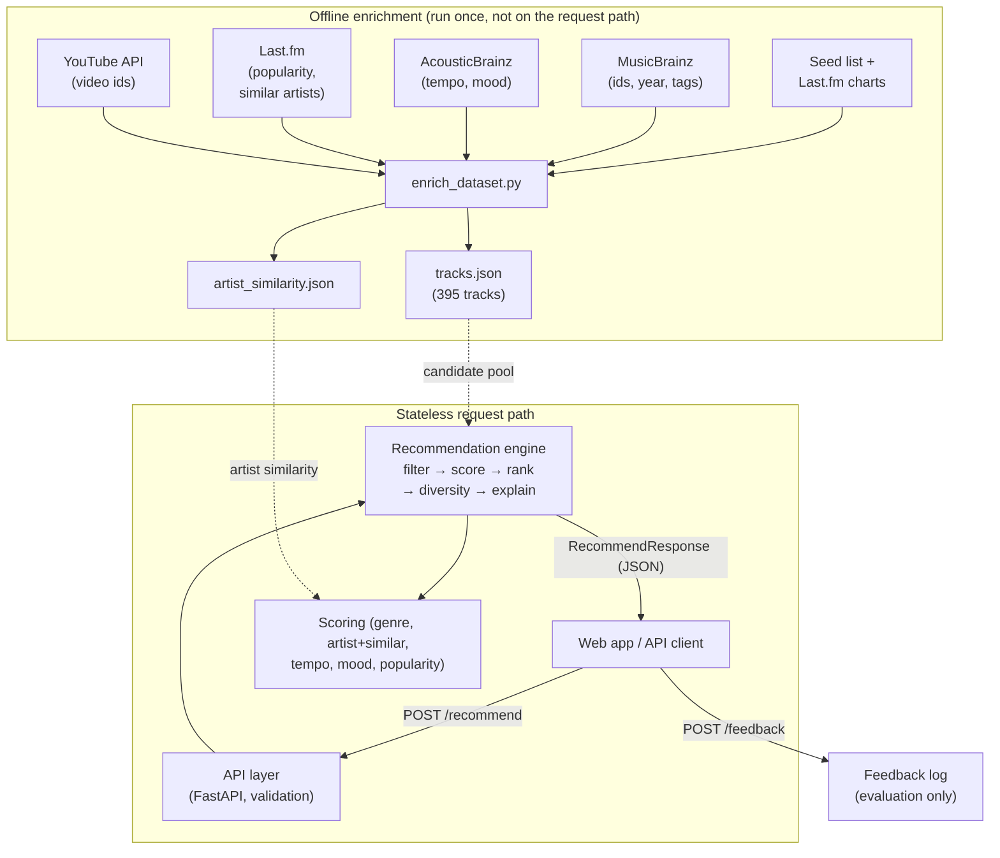
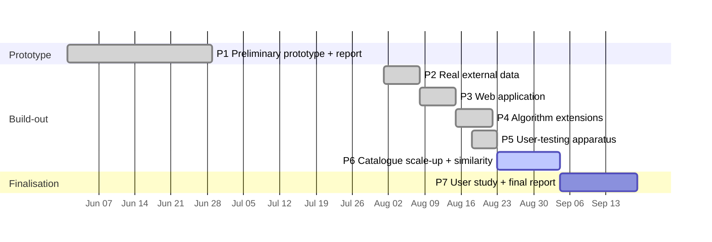

<!--
FINAL REPORT — NextTrack. Canonical draft (v3).
6 chapters per the final-report requirements, with word limits:
  1 Introduction (1000) · 2 Literature Review (2500) · 3 Design (2000)
  4 Implementation (2000) · 5 Evaluation (2500) · 6 Conclusion (1000)
Front matter (title page, contents) and appendices are not counted.
Placeholders in << >> must be filled before submission.
All evaluation figures are the real outputs of scripts/evaluate.py.
Citation details: verify against HARVARD_REFERENCE_LIST.md.
-->

<div style="text-align:center; padding-top:120px;">

# NextTrack — A Stateless, Explainable Music Recommendation API

### Final Project Report

<br><br>

**<< University Name >>**

**<< Course / Module Code and Title >>**

<br>

**Student:** Sardar Muhammad Sachal &nbsp;·&nbsp; **Student ID:** << Student ID >>

**Supervisor:** << Supervisor Name >>

**Submission date:** 19 September 2026

</div>

<div style="page-break-after: always;"></div>

---

## Table of Contents

1. [Introduction](#chapter-1-introduction)
2. [Literature Review](#chapter-2-literature-review)
3. [Design](#chapter-3-design)
4. [Implementation](#chapter-4-implementation)
5. [Evaluation](#chapter-5-evaluation)
6. [Conclusion](#chapter-6-conclusion)
- [References](#references)
- [Appendices](#appendices)

<div style="page-break-after: always;"></div>

---

# Chapter 1: Introduction

## 1.1 Concept and Motivation

Digital music distribution has fundamentally altered how humans consume audio content. Modern commercial streaming platforms—such as Spotify, Apple Music, and YouTube Music—manage libraries encompassing over 100 million tracks. To help users navigate these vast catalogs, platforms rely heavily on automated Music Recommendation Systems (MRSs) and playlist-continuation generators. However, the architectural paradigm underpinning virtually all commercial recommender engines is built around persistent user tracking, centralized profiling, and long-term behavioral logging.

While stateful models driven by collaborative filtering and implicit-feedback tracking yield high predictive precision, they introduce systemic issues:

**Privacy Invasiveness.** Stateful engines require continuous logging of explicit interactions (likes, skips, replays) and implicit signals (timestamped listening events, device identifiers, location). Storing these behavioral footprints on centralized servers exposes sensitive personal data to breaches, unauthorized cross-platform profiling, and commercial exploitation.

**Account Context Pollution.** Stateful profiling assumes one account maps to one listener with stable tastes. In practice, accounts are shared across households, co-workers, or ambient settings (children's lullabies, party background music, gym playlists). These temporary sessions pollute the primary profile, corrupting future recommendations.

**Cold-Start Friction for Ephemeral Listeners.** Stateful engines degrade for new or unauthenticated listeners who lack sufficient interaction history. Ephemeral listeners seeking immediate session continuity without an account are routinely served generic, top-chart recommendations.

NextTrack addresses these limitations by replacing user-centric stateful profiling with a stateless, session-centric architecture. It is a RESTful API that computes the single best "next track" based strictly on the parameters supplied within an individual HTTP POST request—a short sequence of recent track identifiers, optional preference constraints, and candidate metadata. The system retains zero state on the server, persists no user logs or profiles, and still provides contextually aware, explainable recommendations. This emphasis on transparency reflects a wider research interest in explainable recommendation, where systems justify their suggestions to support user understanding and trust (Tintarev and Masthoff, 2007).

## 1.2 Problem Statement

The central challenge is designing an API that delivers contextually accurate, smooth transitions without maintaining user profiles or session logs. Statelessness imposes distinct algorithmic constraints:

- **Absence of user history:** the engine cannot access long-term interaction matrices, historical ratings, or global collaborative-filtering vectors.
- **Inference from minimal data:** musical context—stylistic flow, tempo progression, emotional mood—must be inferred from a limited sequence of track identifiers supplied in the request.
- **Bounded real-time computation:** because scoring occurs within a single HTTP request lifecycle, complexity must remain bounded to guarantee low-latency responses.

## 1.3 Project Template and Scope

This project is undertaken using the supplied template **Project Idea 2: NextTrack — A Music Recommendation API**, which specifies a request-driven service with *no user tracking* that returns a "next track" from a listening history and preference parameters, drawing on external data sources (e.g., MusicBrainz, Last.fm). The scope covers the design, implementation, and evaluation of a system comprising: a **stateless RESTful backend** (Python, FastAPI); a **hybrid content-graph scoring engine** combining metadata filtering, normalized attribute-distance functions, and an offline Last.fm artist-similarity graph; an **explainable decision pipeline** producing natural-language explanations and sub-score breakdowns; and an **interactive single-page web application** with an embedded YouTube player for testing session flows and inspecting scoring diagnostics.

## 1.4 Objectives

The specific objectives are to: (1) design a RESTful API that accepts a listening history, preference parameters, and available track data, and returns a recommended next track with an explanation; (2) build a catalogue of real tracks from external metadata sources, offline, so the request path stays stateless; (3) implement an explainable content-based scoring method and extend it with session-aware taste inference, artist-similarity affinity, and a user-controllable diversity control; (4) provide an interactive web application that plays recommendations and surfaces the explanation and score breakdown; and (5) validate the system with automated tests and evaluate it with an offline random-baseline comparison, a weight-sensitivity analysis, a session-aware-versus-baseline A/B, and the apparatus for a user study.

## 1.5 Report Structure

Chapter 2 reviews recommendation paradigms in MIR and positions NextTrack. Chapter 3 details the architecture, scoring formalisms, weight rationale, and workplan. Chapter 4 describes the implementation and key algorithms. Chapter 5 reports the automated testing and offline evaluations (random baseline, weight sensitivity, session-coherence A/B) and the design and status of a user study. Chapter 6 concludes and proposes further work.

<div style="page-break-after: always;"></div>

---

# Chapter 2: Literature Review

## 2.1 Recommender Systems in Music Information Retrieval

Music Information Retrieval (MIR) is an interdisciplinary domain combining computer science, signal processing, musicology, and cognitive psychology, and recommendation is among its most commercially significant applications. The foundational survey by Adomavicius and Tuzhilin (2005) organises recommendation into three families—content-based, collaborative filtering, and hybrid—a taxonomy that remains the field's conceptual backbone. Music, however, differs from domains such as e-commerce in ways that materially affect design (Schedl et al., 2015): tracks are short and consumed sequentially (dozens per session), so the value of a track depends partly on what preceded it, making the *next-track* decision a meaningful sub-problem; consumption is repetitive yet subject to satiation; and choice is strongly shaped by context—activity, time, and especially mood (Kaminskas and Ricci, 2012). These traits favour a request-driven model in which recent history and explicit preferences are supplied at the moment of the request.

## 2.2 Collaborative Filtering and Matrix Factorization

Collaborative Filtering (CF) predicts interest from consumption patterns shared across many users. **Memory-based** CF operates on a user–item matrix `R ∈ R^(U×I)`, computing similarity across user or item vectors:

```
sim_cosine(u, v) = (u · v) / (‖u‖₂ · ‖v‖₂)
```

In implicit-feedback settings—where explicit ratings are rare—interactions are modelled as binary indicators weighted by confidence from play counts, skips, or duration. **Model-based** CF instead decomposes the sparse matrix into low-rank latent spaces; matrix-factorization models project users and items into a shared space `R^k` (`k ≪ min(|U|,|I|)`), predicting `r̂(u,i) = p_uᵀ q_i` (Koren, Bell and Volinsky, 2009).

CF captures nuanced patterns without item metadata, but for privacy-conscious design it has fundamental drawbacks: it **mandates behavioral tracking** (persistent storage of interaction histories to build user vectors); it suffers the **cold-start problem** for new users and items (Schein et al., 2002); and, as Celma (2010) shows, it concentrates recommendations on high-popularity items, suppressing the long tail. NextTrack therefore does not implement CF, but captures a *lightweight, stateless* echo of its item-based idea through a pre-computed artist-similarity graph rather than a stored user profile.

## 2.3 Content-Based Filtering and Audio Features

Content-Based Filtering (CBF) recommends from item properties rather than interaction matrices (Pazzani and Billsus, 2007). In MIR it draws on two modalities. **High-level editorial metadata** (genre, mood, year, artist) is human-interpretable but suffers vocabulary inconsistency, incomplete coverage, and subjective tagging discrepancies across databases (e.g., MusicBrainz vs. Spotify). **Low-level acoustic features** extracted from the signal include timbral descriptors (MFCCs), rhythmic features (BPM/onset detection), and harmonic features (chromagram/key). CBF is immune to item cold-start and needs no user tracking, and is comparatively transparent (Lops, de Gemmis and Semeraro, 2011); its recognised weaknesses are **over-specialisation** (filter bubbles, limited serendipity) and the **semantic gap** between low-level acoustic features and high-level human perception—early work by Whitman and Ellis (2004) explored using non-content information such as metadata and text to complement audio. NextTrack adopts a metadata-plus-audio hybrid (genre/mood/artist plus tempo and mood from AcousticBrainz) and addresses over-specialisation directly with a diversity control (Chapter 4).

## 2.4 Session-Based and Sequence-Aware Recommendation

Session-Based Recommender Systems predict the next item from an active sequence of interactions rather than a long-term profile. Quadrana, Cremonesi and Jannach (2018) define sequence-aware recommenders as functions over an ordered action sequence `S = (s₁,…,sₙ)` that rank candidates for position `sₙ₊₁`; in stateless setups the user identifier is omitted, making recommendation purely sequence-dependent. Methodologically, early **Markov-chain** models compute transition probabilities `P(sₙ₊₁|sₙ)` but struggle with long-range dependencies and state-space explosion; **RNN/Transformer** models (e.g., GRU4Rec, SASRec) model complex transitions but require GPU inference, ill-suited to a lightweight, low-latency API; and **structured session heuristics** (session-based k-NN, attribute-continuity matching) can be competitive with deep baselines in playlist continuation while remaining lightweight (Jannach, Quadrana and Cremonesi, 2012). Statelessness is also a defining constraint of the REST architectural style (Fielding, 2000), which NextTrack adopts—so an architectural principle, a recommendation strategy, and a privacy posture converge on the same request-driven design.

## 2.5 Explainable Recommendation

Users benefit not only from accurate recommendations but from understanding *why* an item was suggested. Tintarev and Masthoff (2007) identify distinct aims an explanation may serve—transparency, trust, effectiveness, satisfaction—which can require different designs, and later surveys distinguish **model-intrinsic** explanations (arising from an interpretable model) from **post-hoc** ones generated separately to justify an opaque model (Zhang and Chen, 2020). The key insight for this project is that the explanation style should suit the method: content-based systems are naturally suited to model-intrinsic, feature-based explanations, since the attributes driving a recommendation can be surfaced directly as its justification. NextTrack exploits this by composing each explanation only from the features and session signals that actually contributed, distinguishing explicit from inferred matches and exact from similar artists—so the explanation faithfully reflects the computation rather than rationalising it after the fact.

## 2.6 Evaluation of Recommender Systems

Evaluation methodologies fall into three families: **offline** experiments on historical data or a defined objective; **online** experiments (A/B tests) on live traffic; and **user studies** with recruited participants. Offline evaluation is the most common because it is reproducible and inexpensive (Herlocker et al., 2004), and comparison against a **random-selection baseline** is a defensible way to establish that a method beats chance—though the choice of baseline matters greatly, since a baseline drawn from *already-relevant* items is far more demanding than one drawn from the whole catalogue (a distinction that becomes concrete in Section 5.2). Crucially, accuracy-style metrics alone are insufficient. Beyond accuracy, recognised quality dimensions include **coverage**, **novelty**, **diversity**, and **serendipity**; an exclusive focus on accuracy has at times *harmed* recommender systems by neglecting these and genuine user satisfaction (McNee, Riedl and Konstan, 2006), and high offline accuracy may mask popularity bias and poor discovery (Celma, 2010). These cautions directly shaped this project: they motivated both the diversity control and an evaluation that spans several complementary offline measures plus a user study, rather than resting on a single accuracy number.

## 2.7 Synthesis and Comparative Analysis

Across paradigms a consistent set of trade-offs emerges (Table 2.1): CF offers cross-user discovery but depends on accumulated personal data with cold-start and privacy costs; CBF sacrifices some discovery but is transparent, cold-start-resilient, and profile-free; hybrids combine strengths at the cost of complexity; and across all of them, explanation and rigorous, user-aware evaluation are important yet frequently underdeveloped (McNee, Riedl and Konstan, 2006). NextTrack occupies a coherent point in this landscape: content-based (for transparency and cold-start resilience), stateless and session-driven (aligning with REST and reducing reliance on stored profiles), explainable, and API-focused, targeting the over-specialisation and popularity-bias weaknesses the literature identifies.

**Table 2.1 — Comparison of approaches and relevance to NextTrack**

| Approach | Knowledge source | Data required | Key strengths | Key weaknesses | In NextTrack? |
|---|---|---|---|---|---|
| Content-based (Pazzani & Billsus, 2007; Lops et al., 2011) | Item attributes + stated preference | Item metadata only | Transparent; no item cold-start; no profile | Over-specialisation; bounded by metadata | **Yes — core** |
| Collaborative filtering (Koren et al., 2009; Schein et al., 2002) | Behaviour of many users | Accumulated interaction logs | Strong accuracy; non-obvious links | Cold-start; profiling; shared-account failure | No; echoed via similarity graph |
| Hybrid (Adomavicius & Tuzhilin, 2005) | Combination | Metadata + interaction data | Offsets single-method weaknesses | Complexity; inherits CF data needs | No — future work |
| Session/sequence-based (Quadrana et al., 2018; Jannach et al., 2012) | Current interaction sequence | Recent actions only | No persistent profile; privacy-friendly | Limited long-term personalisation | **Yes — session inference** |
| Explainable methods (Tintarev & Masthoff, 2007; Zhang & Chen, 2020) | Justification over any method | Depends on base method | Transparency, trust, satisfaction | Must fit the base method | **Yes — feature-based** |

<div style="page-break-after: always;"></div>

---

# Chapter 3: Design

## 3.1 System Architecture and Modular Boundaries

NextTrack uses modular, decoupled components to ensure separation of concerns, complete backend statelessness, and low-latency processing (Figure 3.1). The **API routing layer** (`app/api/routes.py`) exposes `GET /health`, `GET /catalogue`, `POST /recommend`, and `POST /feedback`. The **schema layer** (`app/models/schemas.py`) uses Pydantic to validate payloads and reject malformed requests before they reach the engine. The **core recommender** (`app/core/recommender.py`) deduplicates candidates, excludes played tracks, infers missing context, applies hard filters, and ranks candidates. The **scoring layer** (`app/core/scoring.py`) contains pure functions computing sub-scores `s_f ∈ [0,1]`; the **similarity module** (`app/core/similarity.py`) reads a static Last.fm artist-similarity graph; and the **explanation builder** (`app/core/explain.py`) turns raw scores and context flags into natural-language sentences. Crucially, the request path is fully stateless and calls no external service: all external data is fetched *once*, offline, and baked into a static catalogue.

**Figure 3.1 — System architecture** *(rendered from the Mermaid source; export at mermaid.live for a high-resolution image to embed)*



**Domain and users.** NextTrack serves two groups. **Direct users** are developers and client applications that send structured JSON requests and require predictable, well-documented, stateless behaviour with clear error handling. **Indirect users** are listeners, who never call the API directly but experience its recommendations, explanations, and playback through a client application—here, the bundled web app. Both are served by computing every recommendation purely from the current request and by making the reasoning inspectable.

**Request flow.** A request to `/recommend` is validated by the API layer (malformed input rejected with HTTP 422) and a candidate pool is selected—either the request's own candidates or the bundled catalogue. The engine then excludes history tracks, applies any explicit genre/mood filters, scores the remainder, ranks them deterministically, applies the diversity control, and generates an explanation before serialising the result as JSON. Two components sit *outside* this path deliberately: the **feedback endpoint**, which is the single place any data is written (anonymous evaluation ratings), and the **offline enrichment stage**, which performs all external network calls in advance so the live service is fast, predictable, and independent of third-party availability or rate limits.

## 3.2 Formal Scoring Model

The total match score for a candidate `c` in session context `C` is a weighted sum of normalized sub-scores, with weights non-negative and normalized to sum to one:

```
S(c, C) = Σ_{f ∈ F} w_f · s_f(c, C),   F = {genre, artist, tempo, mood, popularity},   Σ w_f = 1.0
```

The sub-scores are:

```
s_genre(c,C)      = 1.0  if genre_c = genre_C, else 0.0
s_mood(c,C)       = 1.0  if mood_c  = mood_C,  else 0.0
s_tempo(c,C)      = max(0.0, 1.0 − |tempo_c − target_tempo_C| / 60)      (TEMPO_RANGE_BPM = 60)
s_popularity(c)   = clamp(popularity_c, 0, 100) / 100.0
s_artist(c,C)     = 1.0  if artist_c ∈ A_seed              (exact affinity)
                  = 0.6  else if artist_c ∈ G_sim(A_seed)  (similar affinity)
                  = 0.0  otherwise
```

where `A_seed` is the preferred artist plus recent-history artists and `G_sim` is the Last.fm similarity graph. Genre, mood, and artist are categorical; tempo decays linearly to zero at 60 BPM; popularity is a normalized prior. The total is thus interpretable as the fraction of the weighted preference a candidate satisfies.

## 3.3 Weight Configuration and Justification

Each default weight (Table 3.1) is set by considering three factors together: the feature's **role** in how listening sessions work; its **reliability** as a signal in the available metadata; and the **project's goals** (transparency, session continuation, and discovery rather than popularity bias). A feature strong on role but weak on reliability is deliberately weighted *down*—the asymmetry that turns the numbers into an argument rather than an assertion.

**Table 3.1 — Default weights and rationale**

| Feature | Weight | Rationale |
|---|---|---|
| Genre | 0.40 | The most robust, low-noise axis of similarity and the primary way listeners organise sessions; high role *and* reliability, so it earns the plurality—but below 0.5, so it never single-handedly decides. |
| Artist | 0.20 | A strong affinity signal, weighted below genre because over-weighting exact-artist match causes over-specialisation (Lops et al., 2011); extended to *similar* artists via the similarity graph. |
| Tempo | 0.20 | The axis of energy/flow continuity; a *continuous* signal capturing nuance the binary matches cannot. No higher, as it needs a reliable target and tempo data. |
| Mood | 0.10 | Contextually important (Kaminskas and Ricci, 2012) but weighted *down* on reliability: mood metadata is subjective, sparse, and low-cardinality, making an exact match noisy. |
| Popularity | 0.10 | A weak quality prior and tie-breaker, kept deliberately low to resist popularity bias (Celma, 2010). |

The set encodes a hierarchy—robust categorical similarity (genre) > specific affinity and flow (artist, tempo) > important-but-noisy signals (mood, popularity)—with no feature reaching 0.5 and weights summing to 1.0. These defaults are a sensible prior, not a claim of optimality: they are overridable per request, and their robustness is demonstrated empirically by the sensitivity analysis (Section 5.3). A refinement that emerged from testing is that an *explicitly chosen* genre or mood acts as a **hard filter**, not merely an up-weighted term—because mood's low weight otherwise lets an explicit choice be swamped—while *inferred* preferences remain soft, so the session still flows but the user's explicit selection always wins.

## 3.4 Data Models and Validation

Data interchange is governed by Pydantic schemas. The **Track** model enforces non-empty `id/title/artist/genre/mood` and numerical bounds `tempo ∈ [20,300]`, `year ∈ [1900,2100]`, `popularity ∈ [0,100]`. The **Preferences** model makes all attributes optional and adds control flags `session_aware` (bool, default True) and `diversity` (float, `[0.0,1.0]`). **RecommendRequest** carries `history`, `preferences`, and optional `candidates`; **RecommendResponse** returns `recommended_track`, `score`, `score_breakdown`, `explanation`, and `ranked_alternatives`.

## 3.5 Workplan and Evaluation Strategy

The project ran in phases from the preliminary submission to the final report (Table 3.2, Figure 3.2). The evaluation strategy (Chapter 5) verifies **correctness** with automated tests and assesses **quality** in three offline ways—random-baseline comparison, weight sensitivity, and a session-aware-vs-baseline A/B on session coherence—plus a **user study**, since accuracy alone is insufficient (McNee et al., 2006).

**Table 3.2 — Development milestones**

| Phase | Tasks | Target |
|---|---|---|
| P1 — Preliminary prototype | Stateless API, content-based scoring, history exclusion, explanation, tests, random-baseline evaluation, preliminary report | Late Jun 2026 |
| P2 — Real external data | Offline enrichment (MusicBrainz + AcousticBrainz + Last.fm + YouTube) | Aug wk 1 |
| P3 — Web application | Single-page front end, YouTube player, explanation/breakdown visualisation | Aug wk 2 |
| P4 — Algorithm extensions | Session-aware inference, artist affinity, diversity control; sensitivity analysis | Aug wk 3 |
| P5 — User-testing apparatus | Blind A/B study mode, feedback endpoint, analysis script, protocol | Aug wk 4 |
| P6 — Catalogue scale-up & similarity | Last.fm chart seeding to 395 tracks; similarity map + graded affinity; explicit-preference filtering | Sep wks 1–2 |
| P7 — Final report & study | Run the user study; write and revise the report addressing feedback | By 19 Sep 2026 |

**Figure 3.2 — Project schedule (Gantt)**



<div style="page-break-after: always;"></div>

---

# Chapter 4: Implementation

## 4.1 Technology Stack and Package Structure

NextTrack is implemented in Python. **FastAPI** provides asynchronous performance, automated OpenAPI documentation, and native Pydantic integration; **Uvicorn** serves the ASGI app; and a dependency-free **HTML/CSS/JavaScript** single page (using the YouTube IFrame API) provides the demonstration front end. The API layer is deliberately thin—it validates, selects the candidate pool, delegates to the recommender, and translates the recommender's exceptions into HTTP responses—so the framework-independent core (`app/core`) is unit-testable without a web server.

```
nexttrack/
|-- app/
|   |-- api/routes.py            # RESTful endpoint definitions
|   |-- core/
|   |   |-- explain.py           # Natural-language explanation builder
|   |   |-- recommender.py       # Recommendation orchestration engine
|   |   |-- scoring.py           # Pure scoring functions
|   |   `-- similarity.py        # Static artist-similarity graph loader
|   |-- data/
|   |   |-- artist_similarity.json
|   |   |-- loader.py            # Local dataset loader and validator
|   |   `-- tracks.json          # Bundled track catalog (395 tracks)
|   |-- models/schemas.py        # Pydantic input/output schemas
|   |-- config.py                # Constants and default weights
|   |-- feedback.py              # Anonymous study feedback logger
|   |-- main.py                  # Application entry point
|   `-- web/index.html           # Single-page web player
`-- tests/                       # Automated pytest suites
```

## 4.2 The Recommendation Pipeline

The core `recommend()` function is a single stateless pipeline: (1) reject if no candidates; (2) normalise candidates and drop duplicates; (3) resolve history ids to full tracks *from the pre-exclusion pool* and build the session context; (4) exclude history tracks and (4b) apply explicit genre/mood hard filters; (5) normalise weights; (6) score every candidate; (7) sort deterministically; (8) select via the diversity control; (9) build the explanation and alternatives. Ordering step 3 before step 4 is deliberate—it lets the session signals survive history exclusion. Because the function takes only its arguments and returns only a result object, with no I/O or persistence, it is reproducible and directly testable—the sense in which the whole service is "stateless".

**Request/response and validation.** `POST /recommend` accepts `history`, a `preferences` object, and optional `candidates`; when candidates are omitted, the bundled catalogue is used. Validation is declarative—the request is a Pydantic model, so constraints such as `0 ≤ diversity ≤ 1`, `1 ≤ rating ≤ 5` (feedback), and non-empty text fields are enforced by the schema, and malformed requests are rejected with HTTP 422 before any recommendation logic runs. A successful response returns the recommended track, its total score, a per-feature score breakdown, a natural-language explanation, and ranked alternatives; error paths return a consistent envelope (404 when nothing remains, 400 for invalid weights). The per-feature breakdown is returned to the client and drives both the explanation and the score-breakdown visualisation, so the model's reasoning is fully transparent.

## 4.3 Core Algorithms and Source Code

**Session context inference.** When users omit preferences, context is inferred from recent history:

```python
def _session_context(history_tracks, preferences):
    ctx = SessionContext(genre=preferences.genre, mood=preferences.mood,
                         target_tempo=preferences.target_tempo,
                         preferred_artist=preferences.preferred_artist)
    if not getattr(preferences, "session_aware", True) or not history_tracks:
        return ctx
    recent = history_tracks[-RECENT_HISTORY:]                 # last 5 tracks
    ctx.history_artists = {t["artist"] for t in recent if t.get("artist")}
    if ctx.genre is None:
        genres = [t["genre"] for t in recent if t.get("genre")]
        if genres:
            ctx.genre, ctx.genre_inferred = Counter(genres).most_common(1)[0][0], True
    if ctx.mood is None:
        moods = [t["mood"] for t in recent if t.get("mood")]
        if moods:
            ctx.mood, ctx.mood_inferred = Counter(moods).most_common(1)[0][0], True
    if ctx.target_tempo is None:
        tempos = [t["tempo"] for t in recent if isinstance(t.get("tempo"), int)]
        if tempos:
            ctx.target_tempo, ctx.tempo_inferred = int(round(sum(tempos)/len(tempos))), True
    return ctx
```

**Deterministic scoring and ranking.** Each candidate's weighted breakdown and total are computed, then sorted by a deterministic key:

```python
raw = {
    "genre": score_genre(track["genre"], context.genre),
    "artist": score_artist_affinity(track["artist"], context.preferred_artist,
                                    context.history_artists, similar_artists),
    "tempo": score_tempo(track["tempo"], context.target_tempo),
    "mood": score_mood(track["mood"], context.mood),
    "popularity": score_popularity(track["popularity"]),
}
breakdown = {f: round(raw[f] * weights[f], 4) for f in SCORING_FEATURES}
total = round(sum(breakdown.values()), 4)
# ... then: sort by (-total, -popularity, -year, id)  -> reproducible output
```

**Similar-artist affinity.** The artist sub-score awards partial credit to related artists via the offline Last.fm graph, giving a stateless "more from artists you've played, and related ones" signal:

```python
def score_artist_affinity(candidate_artist, preferred_artist, history_artists, similar_map):
    ca = candidate_artist.lower()
    seeds = {a.lower() for a in ({preferred_artist} | (history_artists or set())) if a}
    if ca in seeds:                                              # exact
        return 1.0
    if similar_map and any(ca in similar_map.get(s, ()) for s in seeds):  # similar
        return 0.6
    return 0.0
```

**Score-weighted diversity sampling.** To counter over-specialisation when `diversity > 0`, the pick is drawn from a *score-aware* window—wide when candidates tie, but collapsing to a single clearly-superior match so it is never diluted:

```python
def _select_with_diversity(scored, history, diversity):
    if diversity <= 0 or len(scored) == 1:
        return scored[0]
    threshold = scored[0]["total"] * (1.0 - diversity)
    window = [s for s in scored if s["total"] >= threshold][:DIVERSITY_MAX_WINDOW]
    if len(window) == 1:
        return window[0]
    seed = int(hashlib.md5(("|".join(history or []) + f"|{diversity:.3f}").encode()).hexdigest(), 16)
    rng = random.Random(seed)                                    # reproducible per request
    weights = [max(s["total"], 0.0) + 0.01 for s in window]
    return rng.choices(window, weights=weights, k=1)[0]
```

## 4.4 Offline Enrichment Pipeline

The 395-track catalogue is built by `enrich_dataset.py` from a fixed seed (hand-curated plus Last.fm chart tracks per genre). A key detail is a **two-database dependency**: AcousticBrainz is keyed by MusicBrainz recording id, so the pipeline resolves each track to candidate ids via MusicBrainz, then queries AcousticBrainz for tempo (`rhythm.bpm`) and mood (high-level classifiers mapped onto calm/energetic/happy). Because coverage is patchy, it *probes several candidate ids and keeps the first with a real BPM*. Popularity comes from Last.fm listener counts (log-scaled) and the similarity graph from `artist.getSimilar`—of 199 artists, 179 have at least one similar artist also in the catalogue. Every call is rate-limited and cached, missing data falls back to per-genre defaults, and because the seed is fixed the catalogue is reproducible. A practical constraint is the YouTube Data API's daily quota (~100 lookups), so 102 of the 395 tracks are currently playable, with the rest carrying full metadata; the web app filters to playable tracks.

## 4.5 Web Application Interface

The single-page interface (`app/web/index.html`) provides preference controls, an embedded player, the explanation and score-breakdown bars, and a session history kept entirely in the browser and sent with each request, so the client is interactive while the server stays stateless. It also embeds the blind study mode used for evaluation (Section 5.5). The client loop is: initialise the catalogue via `GET /catalogue?playable_only=true`; on each *Recommend next*, build a request from the played ids and controls; call `POST /recommend`, load the returned YouTube id, and display the breakdown and explanation. *(Insert screenshots — Appendix B.)*

<div style="page-break-after: always;"></div>

---

# Chapter 5: Evaluation

Correctness and recommendation quality are evaluated separately. All quantitative results are produced by `scripts/evaluate.py` with a fixed random seed and are reproducible.

## 5.1 Automated Testing

Because the scoring and recommendation logic are pure functions, they are tested directly, and the API is tested through FastAPI's in-process client. The suite comprises **55 tests** (Table 5.1), all passing.

**Table 5.1 — Automated test suite**

| Module | Tests | Coverage |
|---|---|---|
| `test_scoring.py` | 22 | Each sub-score in isolation: match/mismatch/missing preference; linear tempo decay; popularity normalization; weight normalization; rejection of negative/all-zero weights. |
| `test_recommender.py` | 25 | Highest-scoring selection, history exclusion, duplicate handling, deterministic tie-breaking, session-aware inference, exact and similar-artist affinity, the diversity control (determinism at 0, reproducibility, variety, exclusion), explicit hard-filtering with graceful relaxation, breakdown/explanation integrity. |
| `test_api.py` | 8 | `/health`; `/recommend` (inline + dataset); required fields; history exclusion; error paths 404/400/422. |

The suite grew from 42 tests at the preliminary stage to 55 as new features were added, each accompanied by tests that also guard previously working behaviour (regression protection).

## 5.2 Comparison Against a Random Baseline

**Method.** For five scenarios, the recommender's chosen-track score is compared with the mean score of `N = 1000` random picks (seed 42) from the same eligible pool:

```
score_random = (1/N) · Σ_{i=1..N} score(random eligible track_i)
improvement% = (score_rec − score_random) / score_random × 100
```

**Result.** On the 395-track catalogue the recommender averaged **0.962** vs a random average of **0.728**, a **+32.3%** improvement, and never recommended a history track (Table 5.2). This should be read in context: because explicit genre and mood act as hard filters, the random baseline draws only from already-relevant tracks (all scoring highly), so it is a far harder comparator than "random over the whole catalogue"—outperforming it by roughly a third, purely by ranking on tempo, popularity, and artist affinity, is a more honest result than a larger figure against an easier baseline.

**Table 5.2 — Recommender vs random baseline (1000 trials/scenario, seed 42)**

| Scenario | Recommender | Random | Improvement |
|---|---|---|---|
| Energetic rock | 0.962 | 0.738 | +30.4% |
| Calm ambient | 0.956 | 0.700 | +36.6% |
| Happy pop | 0.984 | 0.758 | +29.9% |
| Energetic hiphop | 0.969 | 0.750 | +29.3% |
| Calm jazz | 0.939 | 0.694 | +35.3% |
| **Average** | **0.962** | **0.728** | **+32.3%** |

## 5.3 Weight-Sensitivity Analysis

**Method.** Each weight is scaled, one at a time, by {0.5, 0.75, 1.25, 1.5}, re-normalized, and the recommendation recomputed; a *flip* is a change in the top pick. `stability` is the fraction unchanged; `influence(f)` is the fraction of `f`'s perturbations that flipped it.

**Result.** Over 100 perturbations the top recommendation was **stable in 94%** of cases. Perturbing **genre, artist, or mood never changed the pick** (0%)—the strongly weighted match survives ±50% changes—while the pick shifted only on the low-weight tie-breakers **popularity** (20%) and **tempo** (10%). This is the empirical justification for Table 3.1: the recommendation does not hinge on the exact weights, and sensitivity is confined to the features whose role is only to break near-ties.

## 5.4 Session-Aware vs Baseline (A/B on Session Coherence)

**Method.** The session-aware recommender is compared with an explicit-preferences-only baseline (`session_aware = false`) by simulating one seeded session per genre with no explicit preferences, then measuring **session coherence** on metrics *independent of the recommender's own objective*:

```
genre_coherence  = (1/n) · Σ_i [ genre(r_i) = genre(s) ]
mood_coherence   = (1/n) · Σ_i [ mood(r_i)  = mood(s)  ]
artist_affinity  = (1/n) · Σ_i [ artist(r_i) already heard earlier in the session ]
```

**Result (Table 5.3).** With no explicit preferences, the session-aware recommender keeps the session strongly coherent, whereas the baseline drifts toward globally popular tracks. Because the metrics are external to the model's objective, this is a fair test, and it isolates the effect cleanly (the conditions differ only in whether history-based adaptation is enabled).

**Table 5.3 — Session coherence: session-aware vs baseline (one seeded session per genre)**

| Metric | Session-aware | Baseline | Difference |
|---|---|---|---|
| Genre coherence | 100.0% | 8.3% | +91.7 |
| Mood coherence | 90.0% | 36.7% | +53.3 |
| Artist affinity | 53.3% | 0.0% | +53.3 |

## 5.5 User Study (Design and Status)

Because offline metrics cannot establish *perceived* quality, a user-centred evaluation was designed and its apparatus built into the application. In a blind **study mode**, the app randomly assigns the session-aware or baseline method to each recommendation, hides the method (and the explanation and breakdown, which would reveal it), and collects a 1–5 relevance rating logged anonymously via `POST /feedback`; the diversity control is held constant across conditions so it cannot confound the comparison. The planned analysis compares the methods by `Δ = mean(rating | session-aware) − mean(rating | baseline)` with a Mann–Whitney U test at α = 0.05 (`scripts/analyze_feedback.py`). A dry run confirmed ratings are recorded and analysed correctly. **At the time of writing the study with participants has not yet been run, so no participant results are reported here**; running it is the primary outstanding item of the evaluation.

## 5.6 Critical Evaluation

**Achievements.** Measured against the objectives of Chapter 1, the project delivers a working stateless, explainable API; a reproducible 395-track catalogue built entirely from external sources, offline, keeping the request path stateless; a content-based recommender extended with session-aware inference, similar-artist affinity, and a diversity control; an interactive web application with real playback and visualised reasoning; and a four-part evaluation, three parts of which are complete with the apparatus and protocol for the fourth in place. Taken together, the offline evaluation establishes **feasibility and internal validity** on three independent fronts—accuracy over a strong random-among-relevant baseline (5.2), robustness to the exact values of its parameters (5.3), and a substantial, fairly-measured improvement in session coherence (5.4)—backed by a passing 55-test suite. The convergence of these results is stronger evidence than any one alone.

**Limitations and improvements.** The most important limitation is one of *scope*: every offline metric measures the model's objective or a coherence proxy, not human satisfaction, so the user study (5.5) is the decisive outstanding work and its absence is the principal gap in the current evaluation. The catalogue, though real and reproducible, is a demonstration scale (395 tracks), only a subset of which is currently playable owing to the YouTube API's daily quota; at this scale, high genre coherence is easier than over a very large catalogue, so the coherence figures should be read as evidence that the mechanism works, not as a claim about production scale. Categorical matching is transparent but coarse ("rock" and "indie rock" do not match), and audio-derived mood labels are approximate. The coherence metrics are also defined *relative to the session* rather than to any absolute notion of musical quality, and the planned study is small and uses convenience sampling, so its eventual results will be indicative rather than generalisable. **Design lessons from evaluation:** two limitations were surfaced *by using the system* and then corrected—content-based over-specialisation (motivating the score-aware diversity control) and an explicit low-weight mood being swamped (motivating the explicit-preference hard filter)—both now guarded by automated tests; notably, the second change is what strengthened the random baseline in Section 5.2, a healthy sign that the evaluation is sensitive to real behavioural change. The clear next step, once study data is collected, is to use it to *learn* the feature weights and re-test them, closing the empirical loop on the design decision of Section 3.3.

<div style="page-break-after: always;"></div>

---

# Chapter 6: Conclusion

## 6.1 Summary of Contributions

This project designed, implemented, and evaluated NextTrack, a privacy-preserving, stateless RESTful music recommendation API. By replacing stateful profiling with request-bound session inference, it addresses key privacy, context-pollution, and cold-start challenges. The core contributions are: a **stateless API architecture** retaining zero server-side state; a **hybrid scoring engine** combining content-metadata matching, a linear tempo distance function, popularity normalization, and a Last.fm artist-similarity graph; an **explainable output pipeline** producing natural-language explanations and sub-score breakdowns; an **interactive web player** integrated with YouTube; and a **multi-part evaluation** showing the recommender outperforms a strong random-among-relevant baseline (+32.3%), is robust to its exact weights (94% stability), and substantially improves session coherence over an explicit-only baseline (genre 100% vs 8.3%)—together with a complete apparatus and protocol for a user study still to be run.

## 6.2 Broader Themes and Reflection

Two themes stand out. First, **privacy and usefulness need not be opposed**: by treating each request as a self-contained session and drawing knowledge from item metadata and pre-computed similarity rather than a stored profile, the system recovers a useful, stateless echo of behavioural signals without retaining any user data. Second, **using the system was itself a source of design insight**: the diversity control and the treatment of explicit preferences as hard filters were driven by testing in use, illustrating the value of an iterate-and-re-test approach over designing purely on paper. Several trade-offs remain: recommendation precision depends on input-metadata quality; high-level features do not capture fine-grained acoustics (key, harmonic density); the similarity graph is static; and, most importantly, the perceived-quality study has not yet been run, so current evidence establishes feasibility and internal validity rather than proven listener satisfaction.

## 6.3 Future Work

- **Run and iterate on the user study**, then use the ratings to learn the feature weights and re-test them.
- **Fuzzy/semantic similarity** to soften coarse categorical matching (e.g., "rock" vs "indie rock").
- **In-session skip/completion signals** passed within the request, remaining private.
- **Deeper offline hybridisation** (item-item or matrix-factorisation components computed offline) for discovery.
- **Client-side feature extraction** (e.g., BPM/key via WebAssembly) and **harmonic-key compatibility** (Camelot-wheel matching) for smoother transitions, with results attached to the request.

<div style="page-break-after: always;"></div>

---

# References

*Note: bibliographic details (volume, issue, pages, DOIs, editions, access dates) must be checked against each original source before submission; see `HARVARD_REFERENCE_LIST.md` for entries needing particular attention.*

Adomavicius, G. and Tuzhilin, A. (2005) 'Toward the next generation of recommender systems: a survey of the state-of-the-art and possible extensions', *IEEE Transactions on Knowledge and Data Engineering*, 17(6), pp. 734–749.

Celma, Ò. (2010) *Music Recommendation and Discovery: The Long Tail, Long Fail, and Long Play in the Digital Music Space*. Berlin/Heidelberg: Springer.

Fielding, R.T. (2000) *Architectural Styles and the Design of Network-based Software Architectures*. PhD thesis. University of California, Irvine.

Herlocker, J.L., Konstan, J.A., Terveen, L.G. and Riedl, J.T. (2004) 'Evaluating collaborative filtering recommender systems', *ACM Transactions on Information Systems*, 22(1), pp. 5–53.

Jannach, D., Quadrana, M. and Cremonesi, P. (2012) 'Session-based recommender systems', in *Recommender Systems Handbook*. Boston, MA: Springer. [Verify chapter/pages.]

Kaminskas, M. and Ricci, F. (2012) 'Contextual music information retrieval and recommendation: state of the art and challenges', *Computer Science Review*, 6(2–3), pp. 89–119.

Koren, Y., Bell, R. and Volinsky, C. (2009) 'Matrix factorization techniques for recommender systems', *Computer*, 42(8), pp. 30–37.

Lops, P., de Gemmis, M. and Semeraro, G. (2011) 'Content-based recommender systems: state of the art and trends', in *Recommender Systems Handbook*. Boston, MA: Springer, pp. 73–105.

McNee, S.M., Riedl, J. and Konstan, J.A. (2006) 'Being accurate is not enough: how accuracy metrics have hurt recommender systems', in *CHI '06 Extended Abstracts on Human Factors in Computing Systems*. New York: ACM, pp. 1097–1101.

Pazzani, M.J. and Billsus, D. (2007) 'Content-based recommendation systems', in *The Adaptive Web*. LNCS vol. 4321. Berlin/Heidelberg: Springer, pp. 325–341.

Quadrana, M., Cremonesi, P. and Jannach, D. (2018) 'Sequence-aware recommender systems', *ACM Computing Surveys*, 51(4), article 66, pp. 1–36.

Schedl, M., Knees, P., McFee, B., Bogdanov, D. and Kaminskas, M. (2015) 'Music recommender systems', in *Recommender Systems Handbook*. 2nd edn. Boston, MA: Springer, pp. 453–492.

Schein, A.I., Popescul, A., Ungar, L.H. and Pennock, D.M. (2002) 'Methods and metrics for cold-start recommendations', in *Proceedings of the 25th Annual International ACM SIGIR Conference*. New York: ACM, pp. 253–260.

Tintarev, N. and Masthoff, J. (2007) 'A survey of explanations in recommender systems', in *Proceedings of the IEEE 23rd International Conference on Data Engineering Workshop*. IEEE, pp. 801–810.

Whitman, B. and Ellis, D. (2004) 'Automatic record review generation from metadata and audio', in *Proceedings of the International Society for Music Information Retrieval Conference (ISMIR 2004)*.

Zhang, Y. and Chen, X. (2020) 'Explainable recommendation: a survey and new perspectives', *Foundations and Trends in Information Retrieval*, 14(1), pp. 1–101.

<div style="page-break-after: always;"></div>

---

# Appendices

### Appendix A — Example API request and response

**Request** (`POST /recommend`): `{ "history": ["r001"], "preferences": { "genre": "rock", "mood": "energetic", "diversity": 0.3 } }`

**Response** (abridged):

```json
{
  "recommended_track": { "id": "r010", "title": "Uprising", "artist": "Muse",
    "genre": "rock", "tempo": 128, "mood": "energetic", "year": 2009,
    "popularity": 88, "youtube_id": "w8KQmps-Sog" },
  "score": 0.79,
  "explanation": "Recommended \"Uprising\" because it matches the preferred genre rock, matches the energetic mood, is by Muse, an artist similar to your session, and is a popular track.",
  "score_breakdown": { "genre": 0.40, "artist": 0.12, "tempo": 0.17, "mood": 0.10, "popularity": 0.088 }
}
```

### Appendix B — Screenshots
*(Insert.)* Now-Playing panel with a track playing and its explanation/score-breakdown; a session building a coherent set; the blind study-mode rating widget; `pytest` showing 55 passing; and the `evaluate.py` output.

### Appendix C — User study protocol
The full protocol (objectives, hypotheses, blind within-subjects A/B design, participants, procedure, questionnaire, analysis plan, iterate-and-re-test step, threats to validity) is in `USER_STUDY_PLAN.md` and should be reproduced here.

### Appendix D — Testing and evaluation output
*(Insert.)* The `pytest -q` summary (55 passed) and the full `python scripts/evaluate.py` output (random comparison, sensitivity analysis, and A/B session coherence).
